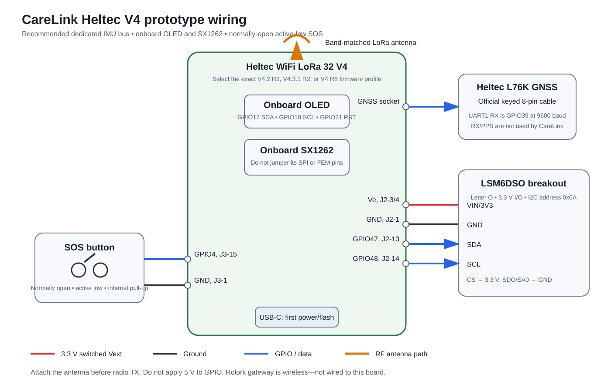

# CareLink Heltec V4 prototype wiring

This wiring matches the GPIO validation and drivers in this repository. It is
intended for a bench prototype using a Heltec WiFi LoRa 32 V4, the official
Heltec L76K GNSS accessory, an LSM6DSO breakout, a dedicated SOS button, the
onboard OLED, a passive-piezo buzzer circuit, and the onboard SX1262 radio.



Identify the exact Heltec revision before connecting power or flashing:

- V4.2 R2 uses the GC1109 radio front end, GPIO36 for Vext, GPIO34 for GNSS
  power, and supports the firmware's onboard battery-voltage measurement.
- V4.3.1 R2 uses the KCT8103L radio front end. It keeps the R2 board power
  selection but requires the V4.3.1 radio profile.
- V4 R8 uses ESP32-S3R8, KCT8103L, GPIO40 for Vext, and GPIO42 for GNSS power.
  Its battery circuit differs and is not measured by the current firmware.

Do not choose a revision from appearance alone. Check the PCB marking and the
ESP32 module marking.

## Prototype bill of materials

| Quantity | Part | Requirement |
| ---: | --- | --- |
| 1 | Heltec WiFi LoRa 32 V4 | Confirm V4.2 R2, V4.3.1 R2, or R8 |
| 1 | LoRa antenna | Correct for the board's actual RF band; attach before enabling TX |
| 1 | Heltec L76K GNSS module and 8-pin cable | Use the keyed GNSS connector; do not force or reverse it |
| 1 | LSM6DSO breakout | LSM6DSO letter O, 3.3 V I/O, I2C, with decoupling and pull-ups |
| 1 | Normally-open momentary SOS button | Connects GPIO4 to ground when pressed |
| 1 | 3.3 V passive piezo transducer | PWM-driven; do not substitute a fixed-tone active buzzer |
| 1 | General-purpose NPN transistor | 2N2222, PN2222A or equivalent low-side driver |
| 1 each | 1 kOhm and 100 kOhm resistors | Base resistor and base-to-ground pull-down |
| 1 | USB-C data cable and regulated supply | Use USB for first bring-up; allow at least 1 A headroom |
| 1 set | 2.54 mm headers/jumpers | Short I2C wiring and a common ground |
| optional | Inline USB power meter | Bench current measurement; no GPIO connection |
| optional | Protected one-cell Li-ion/LiPo | Only after USB-powered validation; verify connector polarity |

The onboard SSD1315 OLED, SX1262, RF front end, battery charger, and R2 battery
divider are already connected on the Heltec board. Do not add a second LoRa
module or connect to the onboard radio SPI pins.

## Recommended wiring

```text
                  Heltec WiFi LoRa 32 V4

       GNSS 8-pin socket  <====== keyed cable ======>  Heltec L76K

       Ve (J2 pin 3 or 4) -------------------------->  LSM6DSO VIN/3V3
       GND (J2 pin 1)     -------------------------->  LSM6DSO GND
       GPIO47 (J2 pin 13) -------------------------->  LSM6DSO SDA
       GPIO48 (J2 pin 14) -------------------------->  LSM6DSO SCL
       Ve (J2 pin 3 or 4) -------------------------->  LSM6DSO CS, if exposed
       GND (J2 pin 1)     -------------------------->  LSM6DSO SDO/SA0
                                                           address 0x6A

       GPIO4              -------- normally-open SOS button -------- GND

       GPIO6 (J3 pin 17) ---- 1 kOhm ----> NPN base
                                      +---- 100 kOhm ----> GND
       GND ------------------------------> NPN emitter
       3V3 ---- piezo (+)   piezo (-) --------> NPN collector

       LoRa IPEX          -------------------------->  band-matched antenna
       USB-C              -------------------------->  PC / regulated USB power
```

Use the labels printed on the board and the official pin map. Header pin 1 is
at the USB-C end. Confirm the labels before inserting jumpers rather than
counting positions from a photo.

### GNSS

For the official Heltec L76K accessory, use the supplied keyed 8-pin cable and
the dedicated GNSS socket. Firmware receives NMEA on UART1 at 9600 baud using
GPIO39. The receiver-to-MCU signal direction is:

| Signal | Connection | Firmware use |
| --- | --- | --- |
| L76K TX | Heltec GNSS socket TX net / GPIO39 | UART1 RX, required |
| L76K RX | Heltec GNSS socket RX net / GPIO38 | Not driven by CareLink |
| PPS | Socket connection | Not used |
| Power and ground | Keyed socket cable | Controlled by the selected R2/R8 board profile |

If using a different breakout instead of the official accessory, connect only
its TX to GPIO39 and share ground for the first test. Power it according to the
breakout documentation. Disable `CARELINK_GNSS_SOCKET_POWER` when the breakout
has an independent supply. Never apply 5 V logic to an ESP32-S3 GPIO.

### LSM6DSO IMU

The recommended prototype uses the dedicated I2C1 bus so an IMU fault cannot
block the onboard display bus:

| Heltec | LSM6DSO breakout | Note |
| --- | --- | --- |
| Ve/Vext, J2 pin 3 or 4 | VIN or 3V3 | Switched 3.3 V; use a compatible breakout |
| GND, J2 pin 1 | GND | Common ground is mandatory |
| GPIO47, J2 pin 13 | SDA | Firmware I2C1 data |
| GPIO48, J2 pin 14 | SCL | Firmware I2C1 clock, 400 kHz |
| Ve/Vext, J2 pin 3 or 4 | CS | Hold high to select I2C when the breakout exposes CS |
| GND, J2 pin 1 | SDO/SA0 | Selects address `0x6A`; use 3.3 V for `0x6B` |

Use one set of I2C pull-ups to 3.3 V. Many breakouts already provide them; do
not add another low-value set without measuring the effective resistance. For a
bare LSM6DSO, follow ST's supply, decoupling, pull-up, and layout requirements.
The current firmware does not use INT1 or INT2, so leave them unconnected.

Do not substitute LSM6DS0 (zero). It has a different register map and is
rejected by the CareLink driver.

### SOS button

Wire a normally-open momentary button between GPIO4 (J3 pin 15) and GND (J3 pin
1). Configure it as active-low with the ESP32 internal pull-up. The firmware
applies 40 ms debounce and requires a 1.5-second hold by default. Do not use
GPIO0/PRG as SOS; it is a boot-strapping and download-mode button.

Button gestures are deliberately distinct: a press gives one short beep, a
1.5-second hold sends a manual SOS and starts the repeating three-beep delivery
pattern, and two quick presses within 450 ms send a caregiver call request with
a two-beep confirmation. The call request uses the authenticated incident
transport; it does not place a cellular voice call from the pendant.

For a breadboard, keep the GPIO4 wire short. A production pendant should add a
reviewed ESD/transient network and verify behavior with a stuck or damaged
button; that protection is not represented by loose prototype wiring.

### SOS buzzer

Use a passive 3.3 V piezo transducer so firmware can generate the configured
2.4 kHz tone. GPIO6 (J3 pin 17) drives a 2N2222/PN2222A-compatible NPN base
through 1 kOhm. Add 100 kOhm from base to ground, connect emitter to ground,
collector to piezo negative, and piezo positive to the board's 3V3 pin. The
transistor prevents buzzer current from being sourced directly by the ESP32.

This circuit is for a piezo transducer. If an electromagnetic sounder is used,
its current and inductive flyback protection require a separate electrical
review. Never connect a 5 V buzzer supply to GPIO6. Firmware rejects GPIO6 when
it conflicts with GNSS, the IMU, or the SOS button.

The non-blocking feedback patterns are:

| SOS stage | Sound |
| --- | --- |
| Buzzer initialized at power-on | One 500 ms self-test beep |
| Button pressed | One short confirmation beep |
| Double press / call request | Two confirmation beeps |
| Contacting gateway | Repeating group of three tones |
| Gateway/cloud receipt | Short confirmation pair |
| Caregiver acknowledged | Two long confirmation tones |
| Cancellation pending | Repeating cancellation pair |
| Resolved/cancelled | Short completion tone or pair |

### OLED, LoRa and Rolork gateway

The OLED is onboard and needs no jumpers. It uses SDA GPIO17, SCL GPIO18, reset
GPIO21 and I2C address `0x3C`. Vext is enabled internally using GPIO36 on R2 or
GPIO40 on R8.

The SX1262 and its RF front end are also onboard. Attach the correct antenna
before enabling the incident service. The Rolork gateway is a separate LoRa
device: it is not electrically wired to the pendant. It must use the same legal
frequency and CareLink radio parameters and implement the authenticated ACK
contract in `docs/sos-protocol.md`.

### Battery and power measurement

Use USB-C for initial testing. Do not feed the USB-C port and the Heltec 5 V
header from separate supplies at the same time. Verify battery-connector
polarity with a multimeter before attaching a protected one-cell battery.

On R2, battery voltage measurement is already wired through the board's
switched 390 kOhm/100 kOhm divider. Firmware briefly enables GPIO37 and samples
GPIO1; no external jumper is required. This is terminal voltage, not an accurate
state-of-charge measurement. R8 battery measurement is not implemented. Use an
inline USB power meter for bench current tests; adding an external fuel gauge
requires a separate reviewed circuit and firmware driver.

## Matching firmware configuration

Set these values in `idf.py menuconfig`:

| Menu | Prototype value |
| --- | --- |
| CareLink board variant | Exact R2 or R8 hardware |
| GNSS socket power | Enabled for the official L76K socket module |
| GPS RX GPIO / baud | GPIO39 / 9600 |
| OLED | Enabled |
| IMU | LSM6DSO enabled, address `0x6A`, shared I2C disabled |
| IMU SDA / SCL / Vext | GPIO47 / GPIO48 / enabled |
| SOS button | Enabled, GPIO4, active-low, pull-up, 450 ms double-press window |
| SOS buzzer | Enabled, GPIO6, 2400 Hz, 50% duty |
| Radio | Enabled with exact V4.2, V4.3.1, or R8 profile |
| Incident service | Enable only after provisioning the device HMAC key |

Radio frequency and power must match the physical board, the Rolork gateway,
and local regulations. The firmware's compatibility defaults are not permission
to transmit.

## Safe bring-up order

1. Leave the battery disconnected. Attach the LoRa antenna.
2. With power off, check for a short between 3.3 V/Vext and GND.
3. Connect the L76K cable, IMU jumpers, SOS button, and buzzer transistor circuit.
4. Recheck GPIO47/GPIO48 orientation, IMU CS/SA0, NPN pinout, and common ground.
5. Power from USB with LoRa and the incident service disabled. Confirm GNSS,
   OLED, IMU identity, and button events in the serial log.
6. Provision a unique LoRa HMAC key and configure the exact board/radio profile.
7. Enable low-power LoRa testing with the Rolork gateway at short range. Confirm
   authenticated receive, ACK, and each buzzer transition before testing retries.
8. Test SOS while GNSS has no fix, during LoRa loss, and across a power cycle.
9. Only after the USB tests pass, verify battery polarity and repeat the tests
   from a protected one-cell battery.

## References

- [Heltec WiFi LoRa 32 V4 documentation](https://wiki.heltec.org/docs/devices/open-source-hardware/esp32-series/lora-32/wifi-lora-32-v4/)
- [Heltec WiFi LoRa 32 V4 R8 pin changes](https://wiki.heltec.org/docs/devices/open-source-hardware/esp32-series/lora-32/wifi-lora-32-v4_r8_board/)
- [Heltec V4.2 datasheet](https://resource.heltec.cn/download/WiFi_LoRa_32_V4/datasheet/WiFi_LoRa_32_V4.2.0.pdf)
- [Heltec V4 pin map](https://resource.heltec.cn/download/WiFi_LoRa_32_V4/Pinmap/V4_pinmap.png)
- [Heltec L76K accessory](https://heltec.org/project/l76-gnss-module/)
- [ST LSM6DSO datasheet](https://www.st.com/resource/en/datasheet/lsm6dso.pdf)
